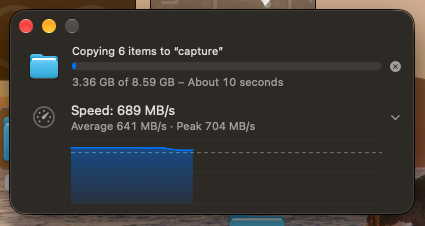

# FinderSpeed

**FinderSpeed** is a native macOS companion utility that brings a Windows Explorer-style live transfer speed readout and a collapsible speed-over-time graph to macOS Finder file copies—without disabling System Integrity Protection (SIP) or injecting code into Finder.

When Finder opens its native copy-progress window, FinderSpeed attaches a seamless extension directly underneath it that merges into **one continuous Finder window**, moving and resizing with it in real time while displaying live throughput (`MB/s` or `GB/s`), average and peak speeds, and an expandable Swift Charts throughput graph aligned with Finder's progress bar. During the first ~3 seconds of a copy (before Finder displays a progress window) or for short copies, a live speedometer readout in the macOS menu bar shows the combined transfer rate.

---

## Screenshot



See [docs/visual-design.md](docs/visual-design.md) for the **Before vs. After** comparison ([docs/images/before.png](docs/images/before.png) → [docs/images/after.png](docs/images/after.png)), pixel-level seam measurements, and how the two-window cap-band and shadow model work.

---

## Features

- **"One Continuous Window" Integration:** Detects Finder's `"Progress"` window (`AXIdentifier == "Progress"`) and seamlessly merges with its bottom edge using a 24-row click-through cap band, custom complementary shadow and `1 px` rim/outline rendering (`0.46 ms`/frame), and live background color sampling (`0` RGB diff with Screen Recording; `~3` RGB units with `.windowBackground` material fallback).
- **Finder-Aligned Columns & Typography:** Matches Finder's exact horizontal grid (`x = 17` gauge icon column, `x = 61` text and graph column at `311 pt` wide, `cx = 385.5` disclosure chevron under Finder's stop button) using Finder's `13 pt` primary and `11 pt` secondary monospaced-digit typography.
- **Borderless Progress-Aligned Graph:** Clicking the chevron smoothly expands a borderless `311 × 64 pt` Swift Charts area/line graph inside the text column whose X-axis maps to fraction completed (`0–100%`), aligning the right edge of the speed curve directly with Finder's progress bar fill above it.
- **Spike-Resistant Telemetry Engine:** Subscribes to Finder's 2 Hz `NSProgress` byte counters via `Progress.addSubscriber(forFileURL:)` with a 5-sample median filter, `0.6 s` windowed rate history, time-aware EMA smoothing, and automatic fallback to Finder's window text counters (`noteWindowRow`) for APFS-clone folder copies.
- **Live Menu Bar Readout:** Displays a `speedometer` status bar icon with live combined throughput from the first ~160 ms of any copy—covering fast transfers under ~3 seconds where Finder never opens a progress window.

---

## Build & Run

**Requirements:** macOS 14.0+ (tested on macOS 27.0.1 arm64), Xcode / Swift 6.4 toolchain.

Build the signed application bundle (`build/FinderSpeed.app`) and launch it:

```bash
scripts/build-app.sh
open build/FinderSpeed.app
```

- Pass `debug` or `release` to `scripts/build-app.sh` (defaults to `release`).
- `FinderSpeed.app` runs as an accessory menu bar app (`LSUIElement = true`, no Dock icon). Click the speedometer icon in the menu bar to inspect active copies, check Accessibility status, open the standalone **Show Demo Panel** (`⌘D`), or quit (`⌘Q`).

---

## Permissions

FinderSpeed runs unsandboxed in user space (no `sudo`, no SIP changes):

| Permission | Requirement | Purpose & How to Grant |
|---|---|---|
| **Accessibility** | **Required** | Needed by `FinderProgressWindowObserver` to detect Finder's `"Progress"` window, track move/resize/close events, and read copy-row text. FinderSpeed prompts on first launch (or via **Grant Accessibility access…** in the menu bar menu) → enable in **System Settings → Privacy & Security → Accessibility**. Preserved across rebuilds via a stable designated code-signing requirement (`identifier "com.mauriziolol.finderspeed"`). |
| **Screen Recording** | **Optional** *(Never prompts)* | Used by `FinderBackgroundSampler` **only if already granted** (`CGPreflightScreenCaptureAccess()`) to sample an `8 × 8` patch of Finder's window margin via `ScreenCaptureKit` for a pixel-perfect (`±0` RGB) background match. FinderSpeed **never prompts** for Screen Recording; without it, the panel falls back to AppKit's `.windowBackground` material (`~3` RGB units off). |
| **Automation — Finder** | **Optional** | Used by `FinderDestinationHints` (`NSAppleEventsUsageDescription`) to query Finder for open browser window folders so `TransferMonitor` can watch arbitrary destination folders. If denied, standard user folders and mounted volumes still work. |

*(Note: Subscribing to `NSProgress` on `~/Desktop`, `~/Documents`, and `~/Downloads` in an unsandboxed app does **not** trigger TCC Files & Folders prompts.)*

---

## Command-Line Flags

Run the binary directly (`.build/release/FinderSpeed` or `build/FinderSpeed.app/Contents/MacOS/FinderSpeed`) with:

- **`--engine-debug [extra_folder ...] [--unwatch-after SECONDS]`**
  Runs `TransferMonitor` headlessly in the terminal and prints watched folders and live transfer state (`preparing`, `copying`, `FINISHED`, `CANCELLED`), smoothed speed, raw sample rate, and full sample history once per second until `Ctrl-C`.
  ```bash
  .build/release/FinderSpeed --engine-debug /Volumes/FinderSpeedTest/copytest
  ```

- **`--render-demo [output_dir]`**
  Renders deterministic 2x Retina PNG snapshots of `SpeedPanelView` (`panel-light-collapsed.png`, `panel-light-expanded.png`, `panel-dark-collapsed.png`, `panel-dark-expanded.png`) into `output_dir` (defaults to `build/snapshots`) and exits.
  ```bash
  .build/release/FinderSpeed --render-demo build/snapshots
  ```

---

## Testing

1. **Unit & Regression Test Suite (`swift test`):**
   Runs **41 deterministic tests across 6 suites** covering EMA math, `TransferMonitor` lifecycle, `noteWindowRow` fallback, review fixes, and Phase 3 delivery-lag spike replays:
   ```bash
   swift test
   ```
2. **End-to-End Finder Copy Benchmark (`scripts/finder-copy-test.sh`):**
   Generates real (non-clone) `/dev/urandom` test files and triggers a real Finder copy via AppleScript to `/Volumes/FinderSpeedTest/<subdir>`, reporting wall-clock time and `first byte -> done` throughput:
   ```bash
   # Copy a 2 GiB file in the foreground
   scripts/finder-copy-test.sh

   # Copy a 4 x 1 GiB folder in the background while watching FinderSpeed.app
   scripts/finder-copy-test.sh -m folder -n 4 -s 1024 -b
   ```

See [docs/testing.md](docs/testing.md) for full details on the test suites and copy-test script options.

---

## Known Limitations

- **No Attached Panel for Copies Under ~3 Seconds:** macOS Finder only opens its copy progress window ~`3.1–3.3 s` into a transfer. Copies that finish in under ~3 seconds never create a window to attach to; the **menu bar readout** still displays their live speed (`NSProgress` fires within ~160 ms).
- **Light Mode Verified Offline Only:** The light-mode chrome and shadow profiles achieved `99.97–99.98%` pixel agreement (`within ±2`) in offline reference compositing (`verify_composite.py`), and light-mode UI snapshots are rendered via `--render-demo`, but live screen captures were only run in dark mode to avoid changing the user's system appearance setting.
- **Retina (`2x`) Displays Untested Live:** The precomputed chrome/shadow lookup tables (`WindowChromeData.swift`) were captured on a `1x` display (`1 pt = 1 px`) and scale via linear filtering on `2x` displays; live verification on a Retina display has not yet been run.
- **APFS-Clone Folder Totals:** When copying a folder made of APFS clones (`cp -c`), Finder's `NSProgress` only counts shared blocks once and freezes after the first file. FinderSpeed automatically switches to Finder's window text byte counter (`usesWindowFallback`) after `1.5 s`.
- **Other Untested Scenarios:** Multi-display setups, macOS Spaces / full-screen transitions, live Finder relaunches (`killall Finder`), and slow network shares (SMB/NFS) or iCloud Drive folders.

---

## Documentation

- [docs/visual-design.md](docs/visual-design.md) — Phase 3 "One Continuous Window" design, before/after comparison, chrome/shadow math, background sampling, and spike elimination
- [docs/architecture.md](docs/architecture.md) — Module layout (`Engine`, `Window`, `UI`, `App`), `TransferMonitor` contract, window attachment, and App wiring
- [docs/feasibility.md](docs/feasibility.md) — Feasibility analysis and results from Spikes A (`NSProgress`), B (`proc_pid_rusage`), and C (`AXUIElement` / `CGWindowList`)
- [docs/testing.md](docs/testing.md) — Unit test suite (`swift test`, 41 tests) and real Finder copy testing (`scripts/finder-copy-test.sh`)
- [CHANGELOG.md](CHANGELOG.md) — Project history
