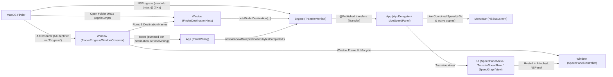

# Architecture: finder-speed

`finder-speed` is structured as a Swift 6.4 package (`Package.swift`) at the repository root with a single executable target, `FinderSpeed` (built via `swift build` or packaged into `build/FinderSpeed.app` via [scripts/build-app.sh](file:///Users/mauriziolol/Projects/finder-speed/scripts/build-app.sh)).

---

## Module Layout & Team Ownership

The executable target `Sources/FinderSpeed/` is divided into four cleanly separated domain folders plus documentation:

| Path | Module / Layer | Owner | Responsibility |
|---|---|---|---|
| `Sources/FinderSpeed/Engine/` | **Engine** | **athena** | `NSProgress` subscription management (`TransferMonitor`), destination folder discovery, byte-counter polling, EMA throughput smoothing, cancel detection, APFS-clone window-byte fallback, sample history, and `--engine-debug` CLI mode (`EngineDebug`). |
| `Sources/FinderSpeed/Window/` | **Window** | **apollo** | Detecting and tracking Finder's native copy-progress window (`FinderProgressWindowObserver`), resolving destination hints (`FinderDestinationHints`), managing Accessibility permissions (`AccessibilityPermission`), and anchoring the companion panel (`SpeedPanelController`). |
| `Sources/FinderSpeed/UI/` | **UI** | **thor** | SwiftUI views rendered inside the companion panel (`SpeedPanelView`, `TransferSpeedRow`, `SpeedGraphView`), Finder-style decimal formatting (`SpeedFormatting`), demo data (`DemoTransfers`), and PNG snapshot rendering (`UISnapshot`). |
| `Sources/FinderSpeed/App/` | **App** | **zeus** | Entry point (`main.swift`), menu bar status item and live readout (`AppDelegate`), and wiring `Engine`, `Window`, and `UI` together with per-destination row summing (`PanelWiring`). |
| `docs/`, `README.md`, `CHANGELOG.md` | **Docs** | **saga** | Architecture specifications, feasibility reports, testing guide, user documentation, and changelog. |

---

## Data Flow



---

## Engine Module (`Sources/FinderSpeed/Engine/`)

Owned by **athena**, the Engine layer consists of [TransferMonitor.swift](file:///Users/mauriziolol/Projects/finder-speed/Sources/FinderSpeed/Engine/TransferMonitor.swift), [Transfer.swift](file:///Users/mauriziolol/Projects/finder-speed/Sources/FinderSpeed/Engine/Transfer.swift), and [EngineDebug.swift](file:///Users/mauriziolol/Projects/finder-speed/Sources/FinderSpeed/Engine/EngineDebug.swift).

### Public Contract: `TransferMonitor`

```swift
@MainActor
public final class TransferMonitor: ObservableObject {
    /// Active (and recently finished) Finder file-copy operations, grouped by destination folder.
    @Published public private(set) var transfers: [Transfer] = []

    public init()
    public func start()
    public func stop()

    /// Permanently watches a specific destination folder URL (non-recursive).
    public func watch(folder: URL)
    public func unwatch(folder: URL)

    /// Hook for the Window module (`FinderDestinationHints`): subscribes immediately to a
    /// destination folder discovered from Finder's copy window or open browser windows.
    /// Late subscriptions deliver already-running copies within ~1 ms; expires after `finderHintLifetime` (600 s) idle.
    public func noteFinderDestination(_ folder: URL)

    /// Hook for the App/Window layer: call once per destination folder per window snapshot with
    /// the SUM of all rows targeting that folder (`bytesCompleted` and `bytesTotal`) and `timestamp: Date()`.
    public func noteWindowRow(
        destination: URL?,
        destinationName: String? = nil,
        bytesCompleted: Int64,
        bytesTotal: Int64? = nil,
        timestamp: Date
    )
}
```

### `Transfer` Model

| Property | Type | Description |
|---|---|---|
| `id` | `UUID` | Stable identifier for the aggregated transfer operation. |
| `destinationFolder` | `URL` | Parent folder URL where items are being copied. |
| `displayName` | `String` | Single item's name (from `NSProgressFileDisplayNameKey`) or `"<N> items"` for multi-item copies. |
| `itemNames` | `[String]` | Individual names of top-level items in the group. |
| `bytesCompleted` | `Int64` | Total bytes transferred so far (`NSProgressByteCompletedCountKey`, or window fallback). |
| `bytesTotal` | `Int64` | Total bytes expected (`NSProgressByteTotalCountKey`, or `0` if unknown/exceeded). |
| `bytesPerSecond` | `Double` | Time-aware EMA smoothed throughput (`0` once finished) for the numeric speed readout. |
| `samples` | `[SpeedSample]` | Chronological time-series of raw (~2 Hz) throughput samples (`time` + `bytesPerSecond`, capped at `2400` = 20 min) for the graph. |
| `isPreparing` | `Bool` | `true` while Finder is enumerating/preparing items (`!isFinished && bytesCompleted <= 0`). |
| `startedAt` | `Date` | Timestamp when the transfer operation was first observed. |
| `isFinished` | `Bool` | `true` after all constituent `NSProgress` handles unpublish (lingers for `finishedLinger = 4.0 s`). |
| `finishedAt` | `Date?` | Timestamp when the transfer completed or was cancelled. |
| `wasCancelled` | `Bool` | `true` if the user cancelled the copy in Finder (`isCancelled` or short of total at unpublish). |
| `averageBytesPerSecond` | `Double?` | Overall average speed across the timed transfer window. |
| `usesWindowFallback` | `Bool` | `true` if the transfer switched to Finder window row text counts (`noteWindowRow`). |

### Engine Mechanics & Review Hardening

1. **Grouping, Revive Window & Deduplication:**
   - Finder publishes one `NSProgress` per top-level destination item with an all-zero `FIOperationUUID`. `TransferMonitor` groups concurrent and sequential items by their destination parent folder (`itemURL.deletingLastPathComponent()`).
   - If a new item arrives in the same folder within `reviveWindow` (`1.0 s`) after finishing, it revives the existing `TransferState` and resets `emaInitialized = false` so the EMA immediately adopts the new transfer's speed instead of ramping from zero.
   - Duplicate handles (when subscribed to both an item and its parent folder) are deduplicated; if `unwatch(folder:)` removes the primary subscription mid-copy, its handle detaches quietly without marking the transfer cancelled and promotes any duplicate handle seamlessly.
2. **Polling, Segment Folding & Time-Aware EMA Smoothing (`SpeedMath`):**
   - `userInfo` is polled every `pollInterval = 0.1 s`, and only actual byte changes (~2 Hz) are timestamped.
   - **Spike prevention:** Segments shorter than `minSegment = 0.3 s` roll their bytes into the next sample rather than emitting noisy rates. Partial final segments at unpublish (`< 0.5 s`) and Finder's completing-update catch-up bursts are counted toward `bytesCompleted` and `averageBytesPerSecond` but excluded from graph samples.
   - Raw rates are smoothed via a continuous-time Exponential Moving Average ($\alpha = 1 - e^{-\Delta t / \tau}$, $\tau = 1.5\text{ s}$). Stalls (`≥ 2.0 s` with no byte change) emit `0 B/s` samples every `0.5 s`.
3. **Cancel Detection (Standard & Window-Fallback Modes):**
   - In standard mode, unpublishing with `progress.isCancelled == true` or `bytesCompleted < bytesTotal` flags `wasCancelled = true`.
   - In window-fallback mode (`usesWindowFallback`), a copy is flagged as cancelled if `windowBytes` falls short of `windowTotal` by more than the tolerance plus ~1 second of throughput.
4. **APFS-Clone Total Quirk & Relative Window Tolerance (`noteWindowRow`):**
   - Copying a folder of APFS clones causes Finder's `NSProgress` to count shared blocks only once and freeze after the first file.
   - When `noteWindowRow(...)` reports a byte count exceeding `NSProgress` by more than `max(windowTolerance [20 MB], 2% × windowBytes)` continuously for `windowSwitchDelay` (`1.5 s`), the transfer switches (`usesWindowBytes = true`) to the window counter. Using a relative `2%` floor prevents false switches on >100 GB copies where Finder's 3-significant-digit text rounds in 100 MB steps.
5. **Lifecycle & TCC-Free Standard Subscriptions:**
   - Subscribes at `start()` to standard user folders (`~`, `~/Desktop`, `~/Downloads`, `~/Documents`, `~/Movies`, `~/Music`, `~/Pictures`, `/Applications`) and browsable mounted volumes (`volumeIsBrowsable != false`), without triggering TCC prompts. Includes an `isolated deinit` and unconditional `stop()` cleanup.

---

## Window Module (`Sources/FinderSpeed/Window/`)

Owned by **apollo** ([spikes/window/PHASE2.md](file:///Users/mauriziolol/Projects/finder-speed/spikes/window/PHASE2.md)), the Window module detects Finder's copy window, extracts row metadata and destination hints, and attaches the floating speed panel. All public types are `@MainActor`.

### 1. [FinderProgressWindowObserver.swift](file:///Users/mauriziolol/Projects/finder-speed/Sources/FinderSpeed/Window/FinderProgressWindowObserver.swift)

- Attaches an `AXObserver` to Finder (`com.apple.finder`) and tracks windows where **`AXIdentifier == "Progress"`**.
- Emits `.appeared`, `.moved`, `.resized`, `.rowsChanged`, `.orderingMayHaveChanged`, `.minimizedChanged`, and `.disappeared` events with a `WindowInfo` snapshot (`windowID`, AppKit `frame`, `axFrame`, `rows: [Row]`, `isMinimized`).
- Each `Row` (matched by `AXProgressIndicator` element order) provides `index`, `title`, `status`, `fraction`, `destinationName` (last quoted name in title), and `statusBytesCompleted` (parsed decimal byte count from `"X of Y"`).

### 2. [FinderDestinationHints.swift](file:///Users/mauriziolol/Projects/finder-speed/Sources/FinderSpeed/Window/FinderDestinationHints.swift)

- Runs `NSAppleScript` on a background serial queue when the progress window appears or an unresolved row `destinationName` is seen (rate-limited to `1.5 s`, max 3 attempts per name; stops on error `-1743` if Automation is denied).
- Queries Finder's `insertion location` and open window `target`s, feeds every candidate to `monitor.noteFinderDestination(_:)`, and resolves `row.destinationName` against open windows, their direct subfolders, mounted volumes, top-level volume folders, and standard user folders.

### 3. [SpeedPanelController.swift](file:///Users/mauriziolol/Projects/finder-speed/Sources/FinderSpeed/Window/SpeedPanelController.swift)

- Hosts the SwiftUI content in a `[.borderless, .nonactivatingPanel]` `NSPanel` with an `NSVisualEffectView` (`.windowBackground`, `bottomCornerRadius = 12`) and `acceptsFirstMouse = true`.
- Positions the panel flush beneath Finder's `"Progress"` window (`width = 404 pt`, `gap = 0`), orders it directly above Finder's `CGWindowID`, hides it when Finder's window is off-screen/minimized or on another Space, and animates height changes (`resizeDuration = 0.2 s`) when the graph expands or collapses.

### 4. [AccessibilityPermission.swift](file:///Users/mauriziolol/Projects/finder-speed/Sources/FinderSpeed/Window/AccessibilityPermission.swift)

- Provides `isTrusted`, `prompt()`, `openSystemSettings()`, and `whenTrusted(pollInterval:_:)`.

---

## UI Module (`Sources/FinderSpeed/UI/`)

Owned by **thor**, the UI module renders the Windows Explorer-inspired speed readout and collapsible throughput chart inside the `404 pt` panel:

| File | Responsibility |
|---|---|
| [SpeedPanelView.swift](file:///Users/mauriziolol/Projects/finder-speed/Sources/FinderSpeed/UI/SpeedPanelView.swift) | Root SwiftUI view accepting `transfers: [Transfer]`. Stacks `TransferSpeedRow` views separated by subtle dividers and sizes itself vertically (`fixedSize(horizontal: false, vertical: true)`) so `SpeedPanelController` automatically adapts its window height. |
| [TransferSpeedRow.swift](file:///Users/mauriziolol/Projects/finder-speed/Sources/FinderSpeed/UI/TransferSpeedRow.swift) | Displays the primary headline (`18 pt` semibold monospaced digits: live speed, `"Preparing…"`, `"Done · avg …"`, or `"Cancelled"`), `<displayName> → <destinationDisplayName>`, the secondary progress/percentage/ETA line, and a circular chevron disclosure button bound to `@AppStorage("graphExpanded")` that toggles `SpeedGraphView` with a `0.2 s` ease-in-out transition. |
| [SpeedGraphView.swift](file:///Users/mauriziolol/Projects/finder-speed/Sources/FinderSpeed/UI/SpeedGraphView.swift) | Swift Charts speed-over-time graph (`chartHeight = 86 pt`) plotting the last `maxWindowSeconds = 120 s` of `SpeedSample`s converted to decimal `MB/s`. Combines a Catmull-Rom `AreaMark` gradient and `LineMark` in `Color.accentColor`, a dashed `RuleMark` for the average speed, trailing Y-axis marks with ~15% rounded headroom above peak, and an `"avg … · peak …"` caption. |
| [SpeedFormatting.swift](file:///Users/mauriziolol/Projects/finder-speed/Sources/FinderSpeed/UI/SpeedFormatting.swift) | Base-1000 decimal formatters (`speed(_:)`, `byteCount(_:)`, `eta(remainingBytes:bytesPerSecond:)`, `progressSummary(...)`, `primaryHeadline(for:)`, `secondaryLine(for:)`) matching Finder's decimal units. |
| [DemoTransfers.swift](file:///Users/mauriziolol/Projects/finder-speed/Sources/FinderSpeed/UI/DemoTransfers.swift) & [UISnapshot.swift](file:///Users/mauriziolol/Projects/finder-speed/Sources/FinderSpeed/UI/UISnapshot.swift) | Deterministic sample transfers (`DemoTransfers.make()`) and `@MainActor UISnapshot.renderDemo(to:)` using `ImageRenderer` (`scale = 2.0`) across light/dark appearances and collapsed/expanded graph states. |

---

## App Module & Integration Wiring (`Sources/FinderSpeed/App/`)

Owned by **zeus**, the App module connects `Engine`, `Window`, and `UI`:

1. **[main.swift](file:///Users/mauriziolol/Projects/finder-speed/Sources/FinderSpeed/App/main.swift):**
   - Intercepts `--engine-debug` (`EngineDebug.run()`) and `--render-demo [dir]` (`UISnapshot.renderDemo(to:)`).
   - Otherwise configures `NSApplication.shared` with `.accessory` activation policy (menu bar only, no Dock icon) and starts `AppDelegate`.
2. **[AppDelegate.swift](file:///Users/mauriziolol/Projects/finder-speed/Sources/FinderSpeed/App/AppDelegate.swift) (Menu Bar Readout & Status Menu):**
   - Owns `TransferMonitor`, starts it on launch, and subscribes to `monitor.$transfers`.
   - **Covers <3 s copies:** Because Finder only opens its `"Progress"` window after ~`3.1–3.3 s`, `updateStatusItem(_:)` displays the combined live speed of all active transfers (or `" Preparing…"`) directly next to the `speedometer` icon in the macOS menu bar starting ~`160 ms` into any copy.
   - Builds the dynamic status menu showing active transfers (`<name> → <dest>: <speed> · <pct>%`), Accessibility permission status/prompt action, **Show Demo Panel** (`⌘D`), and **Quit FinderSpeed** (`⌘Q`).
3. **[PanelWiring.swift](file:///Users/mauriziolol/Projects/finder-speed/Sources/FinderSpeed/App/PanelWiring.swift) (Per-Destination Row Summing):**
   - Instantiates `FinderProgressWindowObserver`, attaches `FinderDestinationHints(monitor: monitor)`, and attaches `SpeedPanelController(content: LiveSpeedPanel(monitor: monitor))`.
   - **Per-destination row aggregation for `noteWindowRow`:** Because Finder's copy window displays one row per operation while `TransferMonitor` groups all operations targeting the same destination folder into a single `Transfer`, `PanelWiring` iterates over `info.rows` on `.appeared` and `.rowsChanged`, **sums `row.statusBytesCompleted` across all rows resolving to the same destination folder**, and invokes `monitor.noteWindowRow(destination:destinationName:bytesCompleted:timestamp:)` once per destination folder per snapshot using a single `Date()` timestamp.
   - Prompts for Accessibility permission if not yet trusted and calls `observer.start()`.

---

## Required Permissions

`finder-speed` runs **unsandboxed** (signed with a stable designated requirement `identifier "com.mauriziolol.finderspeed"` by `scripts/build-app.sh`):

| Permission | Requirement | Why It Is Needed |
|---|---|---|
| **Accessibility** (`AXIsProcessTrusted`) | **Required** | Needed by `FinderProgressWindowObserver` to inspect Finder's `AXWindow` hierarchy (`AXIdentifier == "Progress"`), track `AXMoved` / `AXResized` / `AXUIElementDestroyed`, and read copy-row `AXStaticText`. |
| **Automation — Finder** (`NSAppleEventsUsageDescription`) | **Recommended (Optional)** | Used by `FinderDestinationHints` to query open Finder windows for arbitrary destination folders. If denied (`-1743`), standard folders, volumes, and top-level volume folders still work. |
| **Files & Folders (TCC)** | **Not Triggered by Subscription** | `Progress.addSubscriber(forFileURL:)` on `~/Desktop`, `~/Documents`, and `~/Downloads` does not trigger TCC prompts when unsandboxed, provided directories are not listed. |
| **Screen Recording** | **Not Required** | Not needed because window identification uses Accessibility (`AXIdentifier == "Progress"`) rather than `kCGWindowName`. |
| **Root (`sudo`) / SIP Disable** | **Not Required** | Operates entirely in user space. |

---

## Known Limitations

1. **No Attached Panel for Fast Copies Under ~3 Seconds:**
   - macOS Finder only creates and displays its copy-progress window (`AXIdentifier == "Progress"`) **~3.1–3.3 s** after a copy operation begins. Copies that finish in under ~3 seconds never spawn a Finder window, so there is nothing for `SpeedPanelController` to attach to.
   - **Mitigation:** `NSProgress` publishes within `~160 ms` of copy start, and `AppDelegate.updateStatusItem` displays the live speed in the **menu bar readout** for all copies regardless of duration.
2. **APFS-Clone Folder Copy Totals:**
   - When copying a folder containing APFS-cloned files (`cp -c`), Finder's `NSProgressByteTotalCountKey` only counts unique physical blocks once and stops updating `NSProgressByteCompletedCountKey` after the first file's size, while Finder's window text reports `"X of X"` (`fraction ≈ 0.9999`) as it counts up to the full size.
   - `TransferMonitor.noteWindowRow(...)` detects this after `1.5 s` and switches live speed and completed bytes to the window's byte counter (`usesWindowFallback = true`).
3. **Untested Scenarios:**
   - **Spaces & Full-Screen Transitions:** Hiding/showing the attached panel across macOS Spaces (`kCGWindowIsOnscreen` and `activeSpaceDidChangeNotification`) is implemented in `SpeedPanelController` but not yet verified in automated tests.
   - **Multiple Displays:** Coordinate conversion between AX (top-left of primary screen) and AppKit (bottom-left of primary screen) has only been tested on a single display.
   - **Finder Relaunch (`killall Finder`):** Re-attachment via `NSWorkspace` launch/terminate notifications is implemented in `FinderProgressWindowObserver` but was not live-tested to avoid interrupting concurrent agent transfers.
   - **Network Volumes (SMB / NFS) & iCloud Drive:** All tests were conducted against local APFS volumes and sparse disk images; behavior and `NSProgress` update cadence on slow network shares or iCloud-synced folders (`~/Desktop`) are untested.
