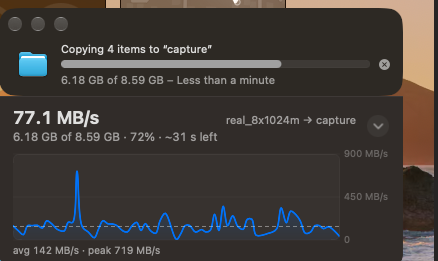
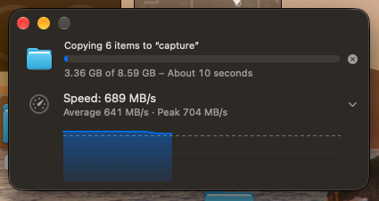

# Phase 3 Visual Design: One Continuous Window

## 1. Before vs. After

| Before Phase 3 ([docs/images/before.png](file:///Users/mauriziolol/Projects/finder-speed/docs/images/before.png)) | After Phase 3 ([docs/images/after.png](file:///Users/mauriziolol/Projects/finder-speed/docs/images/after.png)) |
|---|---|
|  |  |

In the **Before** capture (`build/captures/before/shot-2.png`), the companion panel visibly read as a second window bolted onto the bottom of Finder's dialog:
1. **Separate Window Shapes & Corner Notches:** Finder's 16 px rounded bottom corners met our square-topped panel, leaving two triangular notches where the desktop wallpaper showed through (`build/captures/before/seam-zoom.png`).
2. **1 px Light Top Line:** A `Divider()` at the top of `SpeedPanelView` drew a `1 px` line (`RGB(62, 57, 55)`) across the seam.
3. **Background Color Mismatch:** Finder's dark-mode background was an opaque, wallpaper-tinted `RGB(45, 41, 36)`, whereas the panel's `NSVisualEffectView` rendered at `RGB(49, 44, 41)`.
4. **Doubled Window Shadow:** The panel's own window shadow (`hasShadow = true`) overlapped Finder's shadow.
5. **Unaligned Layout & Spurious Graph Spike:** The panel used an oversized `18 pt` bold headline with no icon column, repeated Finder's byte counts and ETA, wrapped the graph in a bordered box, and suffered from a `719 MB/s` delivery-lag spike on a `~146 MB/s` copy.

In the **After** capture (`build/captures/zeus-after/shot-2.png` / [docs/images/after.png](file:///Users/mauriziolol/Projects/finder-speed/docs/images/after.png)), Finder's progress window and FinderSpeed's panel form **one continuous window**: zero corner notches, zero seam line, `0`-unit RGB background difference (`RGB(45, 41, 36)` vs `RGB(45, 41, 36)`), a single continuous `1 px` outer ring + inner rim + active/inactive shadow, strict column alignment (`x = 17` gauge icon, `x = 61` text and borderless percent-progress graph, `cx = 385.5` chevron), and smooth spike-free throughput curves.

---

## 2. Why We Cannot Resize Finder's Window (`axresize` Experiment)

Using [scripts/tools/axresize.swift](file:///Users/mauriziolol/Projects/finder-speed/scripts/tools/axresize.swift), we tested whether Accessibility (`AXUIElementSetAttributeValue` on `kAXSizeAttribute`) could enlarge Finder's `"Progress"` window (`AXIdentifier == "Progress"`) so our UI could sit inside Finder's own window bounds:

- `AXUIElementIsAttributeSettable` reports `settable = true` and `AXUIElementSetAttributeValue` returns `kAXErrorSuccess` (`0`).
- **Result:** Finder's `"Progress"` window **ignores height changes** and remains fixed at **`404 × 88`**. Therefore, we must visually merge our attached panel with Finder's bottom edge.

---

## 3. Measured Finder Geometry & Chrome Profiles

Measured on a 1x display (`window-relative`, top-left origin) using [scripts/tools/axframes.swift](file:///Users/mauriziolol/Projects/finder-speed/scripts/tools/axframes.swift) and reference window captures (`spikes/window/phase3/refwin.swift`):

| Element | Measurement |
|---|---|
| **Window frame (1 row / 2 rows)** | `404 × 88` / `404 × 149` (`+61 px` per extra row) |
| **Title bar / Content area (1 row)** | `y: 0–32` (`h = 32`) / `y: 32–88` (`h = 56`) |
| **Icon (`AXImage`)** | `x = 17, y = 39, w = 34, h = 34` (column `x: 17–51`) |
| **Title text (`13 pt` regular)** | `x = 61, y = 33, w = 311, h = 16` |
| **Progress bar (`AXProgressIndicator`)** | `x = 62, y = 46, w = 309, h = 20` |
| **Stop button (`AXButton`)** | `x = 378, y = 51, w = 15, h = 10` (center `x ≈ 385.5`) |
| **Status text (`~11 pt` secondary)** | `x = 61, y = 64, w = 311, h = 16` (`8 px` margin above bottom edge) |
| **Bottom corner curve** | Continuous squircle curve extending **18–20 rows** above the bottom edge |
| **Shadow extent (Active / Key)** | Sides: `56 px`, Above: `38 px`, Below: `74 px` |
| **Shadow extent (Inactive / Non-Key)** | Sides: `23 px`, Above: `16 px`, Below: `30 px` |
| **Outer outline ring (dark mode)** | `1 px` outside window: `alpha 246/255` (active) / `224/255` (inactive) |
| **Inner light rim (dark mode)** | `1 px` inside edge (`x = 0`, `x = 403`, bottom row): `background + 22` (active) / `background + 17` (inactive) |

---

## 4. Phase 3 Implementation & Results

### A. Two-Window Chrome & Shadow Model (`Sources/FinderSpeed/Window/` — Apollo)

Detailed report: [spikes/window/PHASE3.md](file:///Users/mauriziolol/Projects/finder-speed/spikes/window/PHASE3.md).

1. **Two Borderless Windows (`hasShadow = false`, `.normal` level):**
   - **Chrome Window (`ignoresMouseEvents = true`, ordered directly above Finder's window):**
     - Extends around the body to draw the computed outer outline ring, inner rim, and shadow, plus the **24-row cap band** above Finder's bottom edge (`24` rows instead of `16` because Finder's continuous squircle corner curvature starts `18–20` rows above the bottom edge).
     - Inside the 24-row cap band, it paints **only** the per-row inverse corner coverage (turning Finder's rounded bottom corners into straight vertical sides) and a `4 px` strip over Finder's bottom rim. All interior pixels in the cap band remain `alpha = 0` so Finder's status text is untouched.
     - Because the chrome window has `ignoresMouseEvents = true`, clicks anywhere in the cap band (both transparent text areas and painted corner pixels) and clicks on our outer shadow pass straight through to Finder or the desktop.
   - **Body Window (`acceptsFirstMouse = true`, non-activating, ordered directly above the Chrome Window):**
     - Frame matches Finder's exact `x` and `width` (`404 pt`), with its top edge at **Finder's exact bottom edge** (`y = 0` in content coordinates). Hosts the matched background fill, the SwiftUI hierarchy, and the `1 px` left/right/bottom inner rim overlay.
2. **Exact Complementary Shadow Math ([WindowChrome.swift](file:///Users/mauriziolol/Projects/finder-speed/Sources/FinderSpeed/Window/WindowChrome.swift), [WindowChromeData.swift](file:///Users/mauriziolol/Projects/finder-speed/Sources/FinderSpeed/Window/WindowChromeData.swift)):**
   - Given target combined-window chrome alpha $A_T$ and Finder's already-drawn window server shadow $A_F$, our chrome window renders black alpha $s = 1 - \frac{1 - u}{1 - A_F}$ where $u = \frac{A_T - \text{cov}}{1 - \text{cov}}$.
   - Tracks `WindowInfo.isActive` (`.activationChanged` event) to switch dynamically between active (key) and inactive shadow/rim profiles, and renders in **`0.46 ms` per frame** in release builds during `60 Hz` (`0.25 s`) expand/collapse height animations.
   - Enforces `minimumContentHeight = 8` so a `1 px`-tall panel never flashes at startup.

### B. Background Sampling & Material Fallback ([FinderBackgroundSampler.swift](file:///Users/mauriziolol/Projects/finder-speed/Sources/FinderSpeed/Window/FinderBackgroundSampler.swift))

macOS computes an `NSVisualEffectView` `.windowBackground` wallpaper tint as a single average color per window based on the desktop region directly beneath that window's frame. Because our panel sits at a different vertical screen position than Finder's window, **no standard AppKit material in our own window produces the exact same RGB tuple as Finder** (typically differing by ~3–4 RGB units).

`FinderBackgroundSampler` solves this with a two-tier strategy:

1. **Pixel-Perfect Sampling via `ScreenCaptureKit` (When Screen Recording Is Already Granted):**
   - Checks `CGPreflightScreenCaptureAccess()`. **It never prompts the user for Screen Recording permission.**
   - If Screen Recording is already granted, it captures an `8 × 8` patch inside Finder's left margin (with our own windows excluded) in the display's color space and takes the median RGB color (`35–110 ms`).
   - Re-samples when Finder's window appears (waiting up to `0.4 s` before fade-in), after window moves (`0.3 s` debounce), on **window resizes** (e.g., when a second concurrent copy expands Finder's window from `88 pt` to `149 pt`, shifting its wallpaper tint from `RGB(45, 41, 36)` to `RGB(43, 38, 33)`), on active/inactive state changes (`0.35 s`), and on light/dark appearance changes.
2. **Automatic Material Fallback (When Screen Recording Is Not Granted or `FINDERSPEED_NO_SAMPLE=1`):**
   - Falls back to `NSVisualEffectView` with `.windowBackground` following Finder's active state.
   - Measured accuracy in fallback mode: `RGB(48, 41, 37)` vs Finder's `RGB(45, 41, 36)` — only **~3 RGB units off**, with all outline, rim, and shadow metrics unchanged.

### C. Measured Pixel Verification (`seam_check.py`)

Verified across single-row (`88 pt`) and two-row (`149 pt`, two concurrent `8 × 1 GiB` copies) live Finder windows:

| Check | Before Phase 3 | After: Active, Expanded (1 Row) | After: Inactive, Collapsed (1 Row) | After: Active, Expanded (2 Rows, `149 pt`) |
|---|---|---|---|---|
| **Background (Finder vs. Panel)** | `(45,41,36)` vs `(49,44,41)` | `(45,41,36)` vs `(45,41,36)` (**diff 0**) | `(45,41,36)` vs `(45,41,36)` (**diff 0**) | `(43,38,33)` vs `(43,38,33)` (**diff 0**) |
| **Seam rows `-7…+3` around Finder bottom** | `1 px` line `(62,57,55)` | **100% within ±2 (max dev 0)** | **100% within ±2 (max dev 0)** | **100% within ±2 (max dev 0)** |
| **Corner area (`900 px` total)** | Wallpaper notches | **0 / 900 pixels > ±2** | **0 / 900 pixels > ±2** | **0 / 900 pixels > ±2** |
| **Outline ring alpha (`x = -1`)** | Separate shapes | `0.96–0.97` continuous | `0.87–0.89` continuous | `0.96–0.97` continuous |
| **Inner rim brightness (`x = 0`)** | Missing on panel | `62 / 62 / 62` | `58 / 57 / 57` | `60 / 60` |
| **Side & bottom shadow vs. reference** | Doubled shadow | `≤ 2/255` | `≤ 5/255` | `≤ 2/255` |

### D. Column-Aligned UI & Percent-Matched Graph (`Sources/FinderSpeed/UI/` — Thor)

1. **[TransferSpeedRow.swift](file:///Users/mauriziolol/Projects/finder-speed/Sources/FinderSpeed/UI/TransferSpeedRow.swift):**
   - **Icon column (`x: 17..<51`, `34 pt`):** Hierarchical secondary `gauge.with.dots.needle.67percent` (`22 pt`).
   - **Text & Graph column (`x: 61..<372`, `311 pt`):**
     - Line 1 (`13 pt` regular monospaced digits): `"Speed: 460 MB/s"` (or `"Preparing…"`, `"Finished · average …"`, `"Cancelled"`).
     - Line 2 (`11 pt` secondary monospaced digits): `"Average 461 MB/s · Peak 572 MB/s"`. Appends `" → <destination>"` only when multiple concurrent transfers are displayed (`showDestination: transfers.count > 1`).
   - **Control column (`x: 372..<399`, center `x = 385.5`):** Plain `10 pt` secondary chevron (`24 × 24` hit target) aligned directly under Finder's stop button.
2. **[SpeedGraphView.swift](file:///Users/mauriziolol/Projects/finder-speed/Sources/FinderSpeed/UI/SpeedGraphView.swift):**
   - Renders a borderless `311 × 64 pt` Swift Chart directly inside the text column.
   - Maps the X-axis to **fraction completed (`0.0...1.0`)** whenever `bytesTotal > 0`, so the right edge of the blue throughput curve lines up vertically with the fill of Finder's progress bar directly above it (falling back to a rolling time axis when total bytes are unknown).

### E. Graph Spike Investigation & Fix (`Sources/FinderSpeed/Engine/` — Athena)

Detailed report: [spikes/progress/SPIKE_719.md](file:///Users/mauriziolol/Projects/finder-speed/spikes/progress/SPIKE_719.md).

- **Root Cause of the `719 MB/s` Spike in `before.png`:**
  - During that capture (`shot-2.png`, `6.18 GB of 8.59 GB` at `42.4 s`, true speed `~146 MB/s`), `NSProgress` cross-process delivery lagged by `~1.5 s` and then caught up in a single `0.5 s` poll window, packing `~2 s` of copied bytes into one segment (`~5×` spike). Smaller recurring `~1.7×` bumps every `~7.3 s` were caused by Finder's inner-file completion catch-up bursts across the `8 × 1 GiB` files.
- **Engine Fix (`RateHistory` in [TransferMonitor.swift](file:///Users/mauriziolol/Projects/finder-speed/Sources/FinderSpeed/Engine/TransferMonitor.swift)):**
  1. **5-sample rolling median filter (`medianWidth = 5`):** Suppresses 1–2 tick delivery-lag spikes (`3.0×` spike reduced to `1.02×` in deterministic replay).
  2. **Windowed raw rates (`rawRateWindow = 0.6 s`):** Computes each raw rate across at least `0.6 s` of real counter history rather than a single segment (`1.56×` inner-file catch-up bumps reduced to `1.02×`).
  3. **Stall-history preservation:** Synthetic `0 B/s` stall samples bypass the median filter so stalls display immediately, but no longer reset the real byte/timestamp baseline (`4.94×` post-stall burst reduced to `< 1.3×`).
  4. **First-value baseline after preparing:** Uses the initial post-preparing tick to anchor `RateHistory` and provides a provisional `bytesPerSecond` until the first windowed sample arrives.
  - Verified by 10 new deterministic replay tests in [SpikeReplayTests.swift](file:///Users/mauriziolol/Projects/finder-speed/Tests/FinderSpeedTests/SpikeReplayTests.swift) (`41/41` total tests passing across 6 suites in `swift test`).

---

## 5. Visual Testing Tools

- **`scripts/capture-copy.sh`:** Runs an `8 × 1 GiB` background Finder copy and captures screenshots (`screencapture -x -R`, without `-o` so Finder's window-server rim and shadow are preserved) plus optional video (`--video SECONDS`).
- **`spikes/window/phase3/seam_check.sh` & `seam_check.py`:** Automated pixel-level verification harness for single-row, two-row (`--two`), active, inactive (`--inactive`), and expanded (`--expand`) states.
- **`scripts/tools/winlist`**, **`scripts/tools/axframes`**, **`scripts/tools/axresize`:** Low-level window list, AX hierarchy frame dumper, and AX resize probe.
